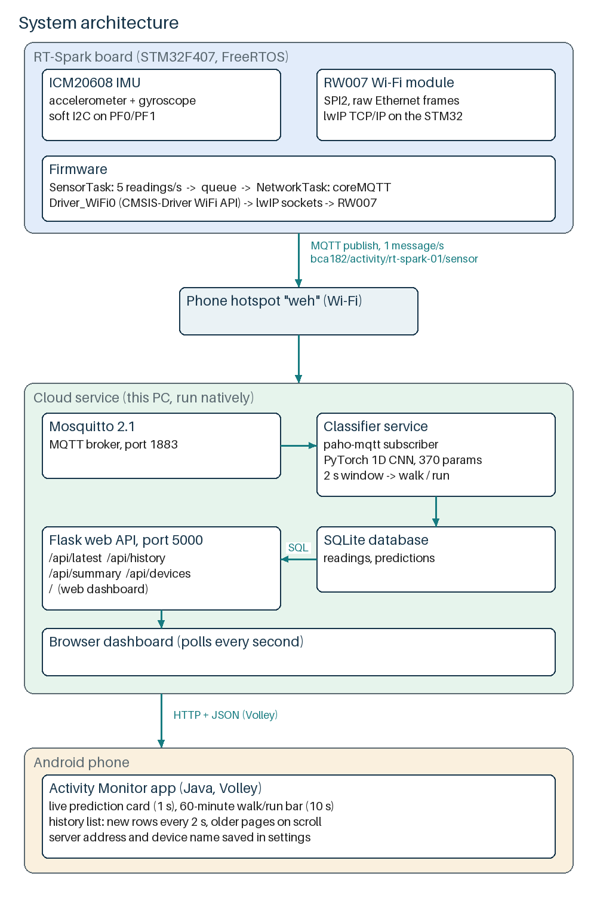
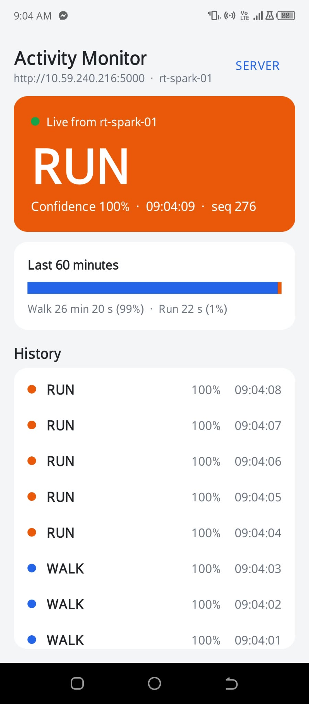
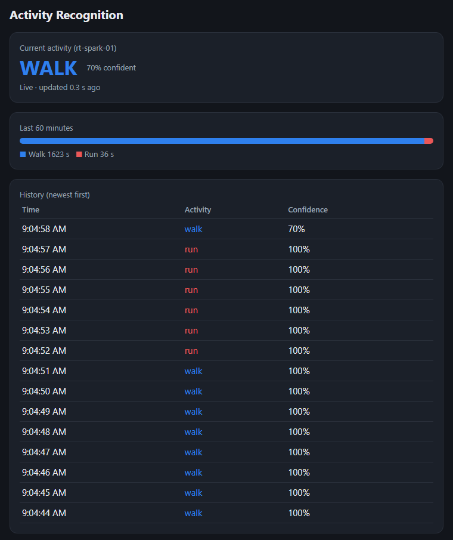
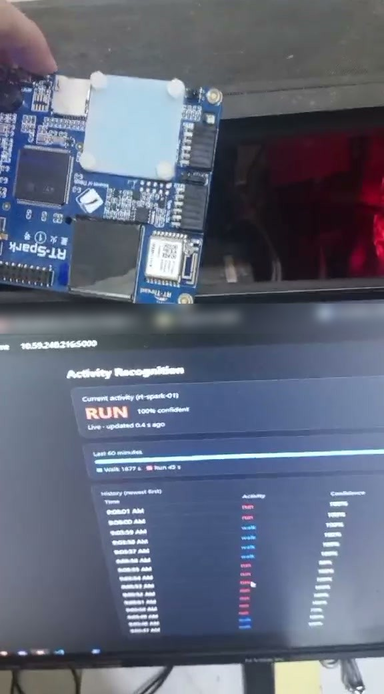

# BCA182 Laboratory Activity 3: Activity Recognition

A full-stack IoT system that recognises whether the wearer is **walking or running**, in real time:

```
RT-Spark board ──MQTT──> Mosquitto ──> PyTorch classifier ──> SQLite ──> Flask web API ──HTTP──> Android app
(IMU + Wi-Fi)                      (cloud service on a PC)                               (Volley)
```



| Part | Folder | Technology |
|---|---|---|
| Machine learning model | [ml/](ml/) | PyTorch 1D CNN, 370 parameters, trained on the Kaggle *run-or-walk* dataset |
| Cloud service | [cloud/](cloud/) | Mosquitto 2.1 MQTT broker, Python classifier service (paho-mqtt), SQLite, Flask web API and dashboard |
| Device firmware | [firmware/](firmware/) | STM32CubeMX + PlatformIO, FreeRTOS, CMSIS-Driver WiFi API, lwIP, AWS coreMQTT |
| Mobile app | [android/](android/) | Java, Volley, RecyclerView |

Results on real hardware are in [docs/functional-verification.md](docs/functional-verification.md), and every
requirement of the lab sheet is traced in [docs/requirements-traceability.md](docs/requirements-traceability.md).
The laboratory report is [docs/laboratory-report.pdf](docs/laboratory-report.pdf).

| Android app | Web dashboard | Board shaken in front of the dashboard |
|---|---|---|
|  |  |  |

## Differences from the lab sheet

The lab sheet was written for a different board and a cloud virtual machine. I kept its structure and
replaced only what could not be used:

| Lab sheet | This project | Why |
|---|---|---|
| LSM6DSL accelerometer/gyroscope | ICM20608 (on-board, I2C address 0x68) | My RT-Spark has an ICM20608, not an LSM6DSL |
| ISM43362 Wi-Fi on SPI3 (+ SPI3 interrupt) | RW007 Wi-Fi on SPI2 (+ SPI2 and INT-pin interrupts) | The RT-Spark's Wi-Fi module is an RW007. I ported RT-Thread's RW007 driver to FreeRTOS and put the CMSIS `Driver_WiFi0` API on top of it, so the lab's sample code runs unchanged |
| CMSIS solution + `cpackget` packs | PlatformIO (`stm32cube` framework) with the same CMSIS-Driver WiFi header and coreMQTT sources | The course uses VSCode + PlatformIO. `MQTT_DO_NOT_USE_CUSTOM_CONFIG` is defined in `platformio.ini`, like the sheet's `solution.yml` |
| Cloud virtual machine (AWS/GCP/Azure) or Docker | The same four services run natively on a Windows PC on the same Wi-Fi | No cloud account was available without a credit card, and Docker could not be installed on this PC. The services are the ones the sheet lists, so moving them to a VM only changes the broker address |
| "Take a sensor reading every second" | 5 readings per second, sent together in one MQTT message per second | The training data was recorded at 5 Hz, so the model needs 5 Hz input. The message rate is still one per second |

## Repository layout

```
ml/         train.py (model search and training), activity_model.py, models/, results/
cloud/      classifier_service.py, api.py, db.py, static/index.html, mosquitto.conf
firmware/   bca182-lab3-firmware.ioc (CubeMX), Core/ (generated), App/ (my code), test/ (unit tests)
android/    Android Studio / Gradle project of the Activity Monitor app
tests/      cloud unit tests (python -m unittest)
tools/      fake_device.py (replays the dataset over MQTT), serial_log.py, make_diagrams.py
scripts/    start_cloud.ps1, setup_network_admin.ps1, build_lab_report.py
docs/       report, verification, traceability, static analysis, images, board logs
```

## How to run it

### 1. Model (already trained; only needed to retrain)

```
pip install -r requirements.txt
python ml/train.py --data path/to/dataset.csv
```

Download `dataset.csv` from https://www.kaggle.com/vmalyi/run-or-walk (it is not redistributed here). Training
writes `ml/models/model.pt`, `model_meta.json` and the comparison tables in
[ml/results/results.md](ml/results/results.md).

### 2. Cloud service (Windows PC)

1. Install Mosquitto 2.x from https://mosquitto.org/download/ (it installs as a Windows service).
2. Once, in an **administrator** PowerShell: `scripts\setup_network_admin.ps1`. It makes Mosquitto listen on the
   network (using [cloud/mosquitto.conf](cloud/mosquitto.conf)) and opens TCP ports 1883 and 5000 in the
   firewall. Mark the Wi-Fi network as **Private**, because Windows may block Python on public networks.
3. Start the classifier and web API: `powershell -ExecutionPolicy Bypass -File scripts\start_cloud.ps1`.
   It prints the PC's addresses.
4. Open `http://<PC address>:5000/` for the dashboard. Without the board, `python tools/fake_device.py --data
   path/to/dataset.csv` sends recorded walking and running data.

Web API (all `GET`, JSON):

| Endpoint | Returns |
|---|---|
| `/api/health` | service status and number of predictions |
| `/api/devices` | devices with their last time seen |
| `/api/latest?device=ID` | newest prediction, its age in seconds and whether the device is live (< 5 s) |
| `/api/history?device=ID&limit=N&before_id=K` | predictions, newest first, paged with `before_id` |
| `/api/summary?device=ID&minutes=M` | seconds of walking and running in the last M minutes |

### 3. Device firmware (RT-Spark)

1. Copy `firmware/App/Inc/wifi_config.h.example` to `wifi_config.h` and set the Wi-Fi name and password
   (2.4 GHz, WPA2) and `MQTT_BROKER_IP` (the PC's address). This file is git-ignored.
2. `cd firmware` and `pio run -e rt_spark -t upload` (VSCode + PlatformIO, board connected with USB).
3. Serial log: 115200 baud on the ST-Link virtual COM port (`python tools/serial_log.py --port COM3`).

The board publishes to `bca182/activity/<device>/sensor`:

```json
{"device":"rt-spark-01","seq":42,"samples":[[ax,ay,az,gx,gy,gz], ... 5 readings]}
```

Acceleration is in g (gravity included) and rotation rate in rad/s, the units of the training data.

### 4. Android app

Open `android/` in Android Studio and run it, or build it from the command line with JDK 17 and the Android SDK:
`gradlew assembleDebug`. The APK is `android/app/build/outputs/apk/debug/app-debug.apk`. In the app, tap
**Server** to set the PC's address (for example `http://192.168.1.10:5000`) and the device name.

## Tests

| What | Command | Result |
|---|---|---|
| Cloud: message parsing, windowing, database, API | `python -m unittest discover -s tests` | 16 tests pass |
| Firmware: IMU conversion and MQTT payload | `cd firmware` then `pio test -e native` | 13 tests pass |
| Firmware static analysis | `pio check -e rt_spark --src-filters="+<App/Src/>"` | 0 high, 0 medium |
| Android Lint | `gradlew lintDebug` | 0 errors |
| Model | `python ml/train.py` (leave-one-day-out) | 99.49% on unseen days, 99.65% with random rotations |

## Credits

- Dataset: Viktor Malyi, *Run or Walk*, Kaggle.
- RW007 SPI protocol ported from RT-Thread's `spi_wifi_rw007.c` (Apache-2.0), see
  [firmware/App/Src/rw007.c](firmware/App/Src/rw007.c).
- AWS coreMQTT (MIT), lwIP (BSD), FreeRTOS (MIT), STM32CubeF4 HAL (BSD-3), ARM CMSIS-Driver (Apache-2.0).
